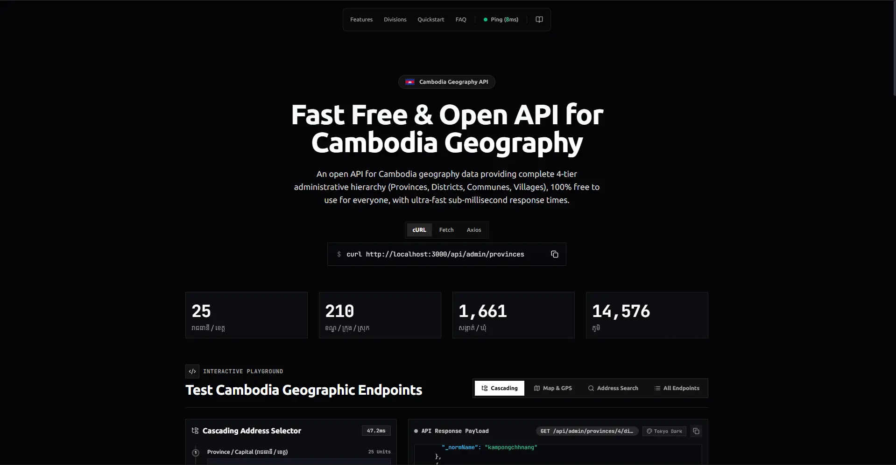

<p align="center">
  
</p>

# OpenGeo Cambodia API

[](https://opengeo-cambodia.pphat.me)
[](https://opengeo-cambodia.pphat.me)
[](https://data.mef.gov.kh/)
[](https://opengeo-cambodia.pphat.me)
[](https://opengeo-cambodia.pphat.me/llms.txt)
[](public/opengeo-cambodia.postman_collection.json)
[](LICENSE)

🔗 **Live Production URL:** [https://opengeo-cambodia.pphat.me](https://opengeo-cambodia.pphat.me)  
🏛️ **Official Data Source:** [https://data.mef.gov.kh/](https://data.mef.gov.kh/) (Ministry of Economy and Finance Open Data Portal)  
📮 **Postman Collection:** [`public/opengeo-cambodia.postman_collection.json`](public/opengeo-cambodia.postman_collection.json) *(Uses collection variables, no environment file needed)*  
🤖 **LLM Reference Context:** [`/llms.txt`](https://opengeo-cambodia.pphat.me/llms.txt) | [`/llms-full.txt`](https://opengeo-cambodia.pphat.me/llms-full.txt)

---

## 🌟 Overview & Purpose

**OpenGeo Cambodia** is a dedicated open API built specifically for Cambodia's geography and administrative data. The dataset is officially sourced from the **Ministry of Economy and Finance Open Data Portal** ([data.mef.gov.kh](https://data.mef.gov.kh/)). The purpose of this project is to solve the critical geographic data accessibility problem in Cambodia by delivering on three core pillars:

1. **Complete Administrative Hierarchy**: Full, authoritative coverage of all 4 official tiers of Cambodian administrative divisions:
   - **Provinces & Capital** (រាជធានី / ខេត្ត) — **25** (1 Capital Municipality + 24 Provinces)
   - **Districts, Khans & Krongs** (ស្រុក / ខណ្ឌ / ក្រុង) — **210** (14 Khans + 32 Krongs + 164 Sroks)
   - **Communes & Sangkats** (ឃុំ / សង្កាត់) — **1,661** (331 Sangkats + 1,330 Khums)
   - **Villages** (ភូមិ) — **14,576** Phums
2. **Allow Users to Use for Free**: 100% free, public, and open access for everyone. No API keys, no subscriptions, no rate-paywalls, and zero cost for developers, startups, e-commerce, logistics, fintech KYC, government initiatives, students, and NGOs under the permissive MIT license.
3. **Provide Fast Response Time**: Ultra-low latency sub-millisecond (< 1ms) lookups. By leveraging pre-indexed, in-memory O(1) hash maps and edge-ready caching, frontend address selectors and backend APIs resolve cascading geographic queries instantly without database bottlenecks or external API delays.

$$\text{City / Province (រាជធានី / ខេត្ត)} \longrightarrow \text{District / Khan / Krong (ស្រុក / ខណ្ឌ / ក្រុង)} \longrightarrow \text{Commune / Sangkat (ឃុំ / សង្កាត់)} \longrightarrow \text{Village (ភូមិ)}$$

---

## 🏛️ Cambodian Administrative Domain Model

| Level | Cambodian Name (KM) | Latin Romanization | Count | OSM Tagging Equivalent |
| :--- | :--- | :--- | :--- | :--- |
| **Tier 1** | រាជធានី / ខេត្ត | Reachdhanie / Khaet | **25** (1 Capital + 24 Provinces) | `boundary=administrative`, `admin_level=4` |
| **Tier 2** | ស្រុក / ខណ្ឌ / ក្រុង | Srok / Khan / Krong | **210** (14 Khans + 32 Krongs + 164 Sroks) | `boundary=administrative`, `admin_level=6` |
| **Tier 3** | ឃុំ / សង្កាត់ | Khum / Sangkat | **1,661** | `boundary=administrative`, `admin_level=8` |
| **Tier 4** | ភូមិ | Phum (Village) | **14,576** | `place=village` / `place=hamlet` *(Nodes)* |

---

## 🏗️ Architecture & Hybrid Strategy

```
[ Web / Mobile Client ]
       │
       ├───> GET /api/admin/* (Dropdowns) ────> [ In-Memory Store / O(1) Index ] (<5ms)
       │                                                 ▲
       │                                                 │ Periodic sync
       │                                          [ Overpass API (OSM) ]
       │
       └───> GET /api/geocode/* (GPS Pin / Search) ──> [ Nominatim OSM API ]
                                                         (Normalized to 4 tiers)
```

1. **In-Memory Store (`AdminStore`)**:
   - Pre-loaded with seed data for all 25 provinces, Phnom Penh's 14 Khans, Siem Reap, Battambang, Preah Sihanouk, Kandal, and Kampot.
   - O(1) hash map indices for parent-to-child lookups.
   - Normalized full-text search tolerating English Romanization variations (*Siem Reap* vs *Siemreap*, *Tuol Kork* vs *Toul Kork*) and native Khmer script.
2. **Reverse Geocoder (`GeocodeService`)**:
   - Integrates with Nominatim with required `User-Agent`.
   - Cascades through fallback keys (`suburb`, `quarter`, `municipality`, `county`, `village`).
3. **ETL Pipeline (`sync:overpass`)**:
   - Offline background batch extractor querying Overpass QL to update datasets without client-side latency.

---

## 🚀 Quick Start

### 1. Prerequisites
- **Node.js** v20+ LTS
- **npm** or **pnpm** / **yarn**

### 2. Installation
```bash
npm install
```

### 3. Run Development Server
```bash
npm run dev
```

The server starts at `http://localhost:3000`:
- **Interactive Web UI**: `http://localhost:3000/demo` (or opening `/` in a browser)
- **API Welcome / Endpoints**: `http://localhost:3000/` (JSON)
- **API Spec & Info**: `http://localhost:3000/api/info`
- **Postman Collection**: `http://localhost:3000/opengeo-cambodia.postman_collection.json`
- **LLM Summary (`llmstxt.org`)**: `http://localhost:3000/llms.txt`
- **LLM Full Specification**: `http://localhost:3000/llms-full.txt`
- **Health Check**: `http://localhost:3000/health`

### 4. Build Backend for Production
```bash
npm run build
npm start
```

### 5. Run Overpass ETL Sync
```bash
npm run sync:overpass
```

### 6. Update Seed Datasets from CSV
```bash
# Update provinces from CambodiaProvinceList.csv
npm run update:provinces

# Update districts from CambodiaDistrictList.csv
npm run update:districts

# Update communes from CambodiaCommuneList.csv
npm run update:communes

# Update villages from CambodiaVillagesList.csv
npm run update:villages

# Update all administrative divisions in one step
npm run update:all
```

---

## 📮 Postman Collection (Variables Included)

You can import the official Postman collection into Postman with **zero environment configuration needed**. The collection comes with built-in **Collection Variables** ready to test out of the box:

- 📥 **Collection File**: [`public/opengeo-cambodia.postman_collection.json`](public/opengeo-cambodia.postman_collection.json) (or download live from `https://opengeo-cambodia.pphat.me/opengeo-cambodia.postman_collection.json`)
- ⚙️ **Collection Variables**:
  - `{{baseUrl}}` — Defaults to `https://opengeo-cambodia.pphat.me` (or `http://localhost:3000` for local testing)
  - `{{provinceId}}` — Pre-set to `12` (Phnom Penh)
  - `{{districtId}}` — Pre-set to `1202` (Khan Doun Penh)
  - `{{communeId}}` — Pre-set to `120201` (Sangkat Phsar Thmei 1)
  - `{{villageId}}` — Pre-set to `12020101` (Phum 1)
  - `{{searchQuery}}` / `{{searchLevel}}` — Pre-set to `Doun Penh` / `district`
  - `{{latitude}}` / `{{longitude}}` — Pre-set to `11.5714`, `104.9250`
- 🧪 **Pre-built Test Assertions**: Every request includes status 200 checks, latency assertions (< 500ms), and schema validations.

---

## 📡 REST API Reference

### 1. Administrative Hierarchy (Instant Dropdowns)

#### List All Provinces / Capital
```http
GET /api/admin/provinces
```
**Response (200 OK):**
```json
{
  "success": true,
  "data": [
    {
      "id": 12,
      "code": "12",
      "name": "Phnom Penh",
      "name_en": "Phnom Penh",
      "name_km": "រាជធានីភ្នំពេញ",
      "typeKm": "រាជធានី",
      "level": "province",
      "lat": 11.5564,
      "lon": 104.9282
    }
  ],
  "meta": {
    "total": 25,
    "tookMs": 0.45,
    "source": "local_cache"
  }
}
```

#### List Districts within a Province
```http
GET /api/admin/provinces/:id/districts
```
Example: `GET /api/admin/provinces/12/districts` returns the 14 Khans of Phnom Penh.

#### List Communes within a District
```http
GET /api/admin/districts/:id/communes
```
Example: `GET /api/admin/districts/1202/communes` returns Sangkats in Khan Doun Penh (Phsar Thmei, Boeng Reang, Phsar Kandal, Voat Phnum, etc.).

#### List Villages within a Commune
```http
GET /api/admin/communes/:id/villages
```
Example: `GET /api/admin/communes/120201/villages` returns Phums within Sangkat Phsar Thmei 1.

#### Resolve Full 4-Tier Hierarchy Path
```http
GET /api/admin/hierarchy/:id
```
Given any division ID (e.g., a village), returns the complete ascending hierarchy:
```json
{
  "success": true,
  "data": {
    "province": { "id": 12, "name_en": "Phnom Penh", "name_km": "រាជធានីភ្នំពេញ" },
    "district": { "id": 1202, "name_en": "Doun Penh", "name_km": "ខណ្ឌដូនពេញ" },
    "commune": { "id": 120201, "name_en": "Phsar Thmei 1", "name_km": "សង្កាត់ផ្សារថ្មីទី១" },
    "village": { "id": 12020101, "name_en": "Phum 1", "name_km": "ភូមិ១" }
  }
}
```

#### Administrative Search
```http
GET /api/admin/search?q=Doun+Penh&level=district&limit=10
```

---

### 2. Smart Geocoding & Address Autocomplete

#### GPS Reverse Geocoding
```http
GET /api/geocode/reverse?lat=11.5714&lon=104.9250
```
**Response (200 OK):**
```json
{
  "success": true,
  "data": {
    "displayName": "Doun Penh, Phnom Penh, 120201, Cambodia",
    "lat": 11.5714,
    "lon": 104.925,
    "hierarchy": {
      "province": "Phnom Penh",
      "district": "Doun Penh",
      "commune": "Phsar Thmei 1",
      "village": null,
      "country": "Cambodia"
    }
  },
  "meta": {
    "tookMs": 142.3,
    "source": "nominatim"
  }
}
```

#### Free-text Address Autocomplete
```http
GET /api/geocode/search?q=Wat+Phnom&limit=5
```

---

## 🛠️ Project Structure

```text
opengeo-cambodia.pphat.me/
├── package.json
├── tsconfig.json
├── .env.example
├── .gitignore
├── README.md
├── context.md
└── src/
    ├── index.ts               # Server entry point using @hono/node-server
    ├── app.ts                 # Hono app configuration, CORS, Logger, routes
    ├── config.ts              # Environment settings and constants
    ├── types/
    │   ├── admin.ts           # AdminItem, AdminLevel, Hierarchy contracts
    │   ├── geocode.ts         # GeocodeResult, Nominatim types
    │   └── api.ts             # Standardized API response envelope
    ├── data/
    │   ├── store.ts           # High-performance In-Memory repository (O(1) index)
    │   └── seed/
    │       ├── provinces.json # Seed data for all 25 provinces
    │       ├── districts.json # Seed data for districts
    │       ├── communes.json  # Seed data for communes
    │       └── villages.json  # Seed data for villages
    ├── routes/
    │   ├── admin.routes.ts    # /api/admin/* endpoints
    │   ├── geocode.routes.ts  # /api/geocode/* endpoints
    │   └── health.routes.ts   # /health and /api/info
    ├── services/
    │   ├── admin.service.ts   # Dropdown cascading logic
    │   ├── geocode.service.ts # 4-tier key normalization & fallback cascade
    │   └── nominatim.client.ts# OSM Nominatim HTTP client
    ├── scripts/
    │   ├── copy-assets.ts     # Asset bundling script for production builds
    │   ├── sync-overpass.ts   # Background ETL pipeline from Overpass API
    │   └── convert-csv.ts     # CSV data ingestion and conversion utilities
    └── views/
        └── demo.html          # Interactive Web UI with live timing & geocoder
```

---

## 🤖 LLM & AI Agent Integration (`llms.txt`)

OpenGeo Cambodia conforms to the [llmstxt.org](https://llmstxt.org) standard for AI coding assistants (ChatGPT, Claude, Cursor, Copilot, Antigravity, and autonomous web agents):

- **Compact LLM Context**: [`/llms.txt`](https://opengeo-cambodia.pphat.me/llms.txt) — Token-efficient summary of 4-tier domain model, base URLs, rate limits, and quick-start integration snippets.
- **Full LLM Reference**: [`/llms-full.txt`](https://opengeo-cambodia.pphat.me/llms-full.txt) — Comprehensive single-file reference containing complete JSON schemas, parameter types, error handling, and TypeScript/Python SDK code.

### Using with Cursor or Claude
Add the URL directly to your project prompt or `.cursorrules`:
```
Always use https://opengeo-cambodia.pphat.me/llms.txt for Cambodian administrative boundary and address normalization rules.
```

---

## 📜 License

Distributed under the MIT License. See [`LICENSE`](LICENSE) for more information.

Copyright (c) 2026 PPhat (pphat.me)
